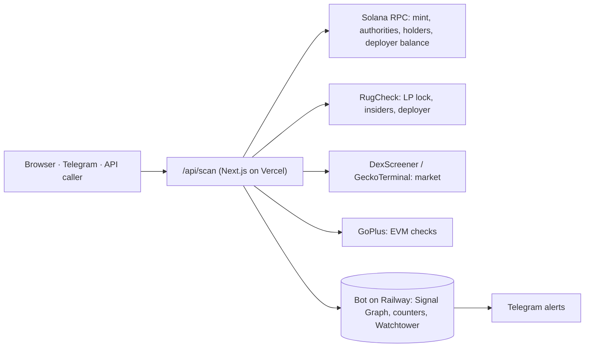

# GL1TCH — scan before you buy

**A free, open-source token safety scanner for Solana (plus 15 EVM chains).** Paste any token
and get a 0–100 risk score with a plain-language reason for every check, in seconds. Read-only:
it never asks for a signature, never touches a wallet, and costs nothing to use.

- Scanner: <https://gl1tchbased.xyz/scan>
- Rug Radar (risky new launches, swept every 30 minutes): <https://gl1tchbased.xyz/radar>
- Proof page (we run the scanner on our own token): <https://gl1tchbased.xyz/proof>
- Telegram bot: scan from chat, plus Watchtower alerts — <https://t.me/gl1tch_infected>
- License: [MIT](./LICENSE)

## Why it exists

Most tokens launched on Pump.fun collapse shortly after launch (Solidus Labs counted 98.6% of
7M+ tokens from Jan 2024 to Mar 2025 as pump-and-dumps). The warning signs sit in on-chain
state that buyers can't read: a live mint authority, a freeze authority, a hidden Token-2022
transfer fee, unlocked liquidity, bundled sniper wallets, a deployer with a history of rugs.
GL1TCH reads that state, explains it in plain words, and gives it away for free.

## What every Solana scan checks

| Check | What it catches |
| --- | --- |
| Mint authority | Can someone still print new supply? |
| Freeze authority | Can your wallet be frozen so you can't sell? |
| Transfer tax | Hidden Token-2022 transfer-fee extensions |
| Liquidity | Depth, and fabricated depth (huge pool, no trades) |
| LP locked / burned | Can the dev pull the pool? |
| Top holder / insiders | Concentration and bundled or insider wallets |
| Deployer | The launching wallet's track record across tokens |
| Deployer holdings | How much of the supply the deployer holds right now (dump risk, or exited) |
| Metadata | Can the name and image still be swapped? |
| RugCheck | An independent second opinion |

EVM chains use GoPlus for honeypot, sell tax, mintable, ownership, pausable and blacklist checks.
Every scan also feeds the **Signal Graph**, a cross-scan memory of deployers, so a serial
rugger's next token is flagged. Scoring changes are logged in
[`docs/scoring-changelog.md`](./docs/scoring-changelog.md).

## Use it from your own app (free, no key)

```js
// Full safety report for one token
const r = await fetch("https://gl1tchbased.xyz/api/scan?mint=<address>&chain=solana");
const report = await r.json(); // { verdict, score, confidence, checks[], meta, bottomLine, ... }

// Search by name or symbol across chains
const s = await fetch("https://gl1tchbased.xyz/api/scan?q=bonk").then((x) => x.json()); // { candidates }
```

Verdicts: `CLEAN`, `LOW RISK`, `CAUTION`, `HIGH RISK`, `RUG-SHAPED`, `UNKNOWN`. The API is rate
limited per IP (40 requests/min), the same for every caller. If you are building an integration
that needs more, ask at [founder@gl1tchbased.xyz](mailto:founder@gl1tchbased.xyz); it stays free.

Embed a live badge that links to the full report:

```html
<a href="https://gl1tchbased.xyz/scan/solana-<address>">
  " alt="Scanned by GL1TCH" />
</a>
```

Machine-readable docs for agents: <https://gl1tchbased.xyz/llms.txt>.

## How it's built



| Path | What lives there |
| --- | --- |
| `src/lib/scan.ts`, `src/lib/scan-multichain.ts` | The scan engine: checks, weights, verdicts |
| `src/app/api/` | Public API routes (scan, badge, radar, stats, agent check) |
| `src/app/` | The website (Next.js App Router) |
| `bot/` | Telegram bot, Watchtower sweeps, Signal Graph and counters, stored on a Railway volume (no database) |
| `docs/` | Threat model, risk register, scoring changelog, Signal Graph schema, specs |
| `remotion/`, `e2e/` | Video pipeline and browser automation (not needed to run the scanner) |

## Run it locally

Requires Node.js 22.

```bash
npm install
cp .env.example .env.local   # optional: a private Solana RPC in SCAN_RPC; public RPCs work for light use
npm run dev                  # http://localhost:3000/scan
npm test                     # unit tests (vitest)

cd bot && npm install && npm test   # the Telegram bot has its own package and tests
```

CI type-checks and tests the site and the bot on every push, and a security workflow runs a
secret scan, a dependency audit and a check that no code ever requests a fund-moving or
approval signature.

## Security and honesty

- Read-only by design. The scanner and bot never request a transaction signature. See
  [`SECURITY.md`](./SECURITY.md) to report a vulnerability, and
  [`docs/threat-model.md`](./docs/threat-model.md).
- A verdict is a risk signal, not a guarantee, and never financial advice.
- Verdict anchoring (built, not live on mainnet yet): each Rug Radar sweep's verdicts are sealed on Solana as
  a Merkle root in one SPL Memo, so anyone can prove a verdict existed at that time, unedited. The memos are
  signed by a dedicated fee-only attester wallet, never a user's. Check one in your browser at
  <https://gl1tchbased.xyz/verify-scan>; the spec is [`docs/verdict-anchoring.md`](./docs/verdict-anchoring.md).
- Public numbers come with their caveats: the scan counter's all-time total includes automated
  Rug Radar sweeps; since 20 Oct 2026 people's scans and automated ones are counted separately
  (`/api/stats` returns `user`, `auto` and `splitSince`, or a 503 while the counter is unreachable,
  never a made-up 0).

## The $GL1TCH token (disclosure)

The project also has a community token, `$GL1TCH`
(`3HQJwwHvzy8pGkPqGQcb4thZCH88MUCHVVSNtHn6pump`), launched on Pump.fun on 29 May 2026:
Token-2022, mint and freeze authority revoked, 0% tax, fixed 1B supply, liquidity locked.

- **Safety is never token-gated.** The scanner, its API, the badge, Rug Radar and Watchtower
  are free for everyone. Holding the token only unlocks community ranks and the
  verifiable-randomness API.
- **Deployer wallet:** sold its full position on 2026-08-20, then bought back about 3.1% of
  supply on 17–19 Oct 2026. The live balance and both receipts are on the
  [Proof page](https://gl1tchbased.xyz/proof).
- The market is very thin. Grant funding is never used for the token, buybacks or liquidity.

More: [whitepaper](https://gl1tchbased.xyz/whitepaper) ·
[token page](https://gl1tchbased.xyz/token) ·
[Quantum Core and verifiable randomness](https://gl1tchbased.xyz/quantum-core).

## Contributing

Issues and pull requests are welcome. See [`CONTRIBUTING.md`](./CONTRIBUTING.md).
